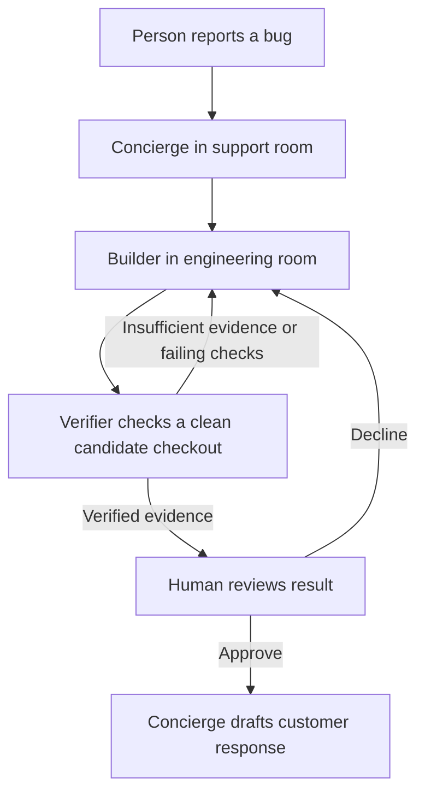

# ProofDesk implementation plan

Turn a customer bug report into a reproducible failure, a proposed patch, an independently checked result, and a human-approved response. Target the Business Workflow track. This is a proposed design, not implemented functionality or a guarantee of competitive uniqueness.

The event evaluates Switch usage, execution, creativity/impact, and presentation. Build the demonstration around those criteria. [Official challenge](https://www.wemakedevs.org/hackathons/switch).

## Implementation status

Live milestone update: **PD-41b429bc34c2 reached CLOSED** through actual Discord/Switch/Codex collaboration, independent verification, dashboard approval by the person, and Concierge's unsent draft/closure. See [completed live run](docs/LIVE-RUN.md). Earlier pending notes below describe the environment before this successful run. Final recording, clean-checkout validation, and submission remain outstanding.

Started November 4, 2026. The local state machine, Git snapshot verifier, evidence files, separate review command, reply draft, and labelled fixture rehearsal are implemented. Agent instructions and a draft Switch template are prepared. The automated suite exercises rejection, revised candidates, review/closure, deduplication, clarification, stale decisions, invalid output, and evidence integrity.

**Live integration remains pending:** Docker's engine was unavailable during the environment check; no running Switch process was observed. Provider sign-in, template import, room addressing, genuine agent-generated fixes, transcript capture, and recording must be verified before calling this a completed Switch entry.

Detailed contracts: [workflow specification](docs/WORKFLOW-SPEC.md), [compliance checklist](docs/COMPLIANCE.md), [setup](docs/setup.md), and [demo runbook](docs/demo.md). The numbered milestones below are the full delivery backlog; local implementation does not mark live integration complete.

November 7 update: the local operator dashboard is implemented with real case reads, diff/check/timeline inspection, asynchronous verification, review bound to the verification evidence hash, unsent drafts, closure, and HTML export. There are 26 passing automated tests plus disposable browser QA. The live preparation helper and environment doctor are implemented. This extends the original no-frontend MVP in response to the requested design work; live Switch integration still has priority. See [workspace guide](docs/WORKSPACE.md), [live setup](docs/LIVE-SETUP.md), and [finish plan](FINISH-PLAN.md).

## Approach

Use three agents in two Switch rooms. Switch carries requests, shared context, evidence links, and handoffs; a small Python utility records case state and runs verification commands. Finish one complete workflow before adding optional integrations or visual presentation.

Assume a solo builder, an existing coding-agent subscription, Python for the demo application and tests, and Mattermost for the first working exchange. Connect Discord afterward if time permits. Multiple agents can use the same provider; different models are optional.

## Scope

- In: one sample application, three agent roles, two rooms, explicit handoffs, one rejection/revision cycle, evidence files, a human release decision, reproducible setup.
- Out for the MVP: production deployment, actual customer messaging, automatic merging, a custom agent protocol client, a new frontend, multiple chat platforms, payments or production credentials.

## Workflow

| Participant | Responsibility | Output |
| --- | --- | --- |
| Concierge | Clarify the report, create a case, hand off, summarize the outcome | Case brief and final reply draft |
| Builder | Reproduce the issue, add a regression test, prepare a patch | Failing baseline evidence and candidate commit |
| Verifier | Check the candidate separately and challenge unsupported claims | Independent verdict and test evidence |
| Human | Review the patch and decide whether to accept it | Approval or rejection recorded against the candidate |

Configure addressing so Concierge can hand work to Builder and Builder can reach Verifier. Give Builder and Verifier access to the engineering room; keep Concierge in the support room and let Builder post a concise result there. Link the rooms in both directions, but do not assume links grant membership. [Room relationships](https://docs.switchagents.ai/switch-rooms/building/grow-into-an-organization).

## Standout demonstration

Use a tiny order-summary application with a documented money-rounding rule. A customer reports that a discount produces the wrong total. Builder reproduces the problem and proposes a change; Verifier checks the failing baseline, expected total, rounding boundaries, and unaffected cases.

For a repeatable rejection demonstration, include an explicitly labelled incomplete candidate fixture. Have Verifier execute real checks against it and reject it, then execute checks against the corrected candidate. Do not present a fixture as an agent's spontaneous mistake or a stored transcript as live execution.

Finish by showing the changed source, test output, case evidence, and reply draft. The visible result should answer: what failed, what changed, who checked it, and what the human accepted?

## Action items

### Milestone 1: Prove the connection — November 4

- [ ] Record installed Console, server, and provider versions in `docs/setup.md`.
- [ ] Get one agent answering an exact mention in a Mattermost room.
- [x] Create `demo-app/` with a small Python order-total function and an external acceptance suite.
- [x] Document expected rounding behavior and a realistic sample complaint in `fixtures/`.
- [x] Create `agents/concierge.md`, `agents/builder.md`, and `agents/verifier.md` with bounded responsibilities and output contracts.
- [ ] Configure two rooms, memberships, addressing permissions, and shared references.
- [ ] Verify an actual Concierge → Builder → Verifier message handoff.

Exit criterion: a person asks a question in chat and gets a sourced response through the configured handoff.

### Milestone 2: Complete the case — November 5

- [x] Define the case record containing ID, report, baseline commit, candidate commit, state, evidence paths, verification verdict, and approval reference.
- [x] Implement a small `workflow/` CLI that enforces transition preconditions and stores cases under `.proofdesk/cases/<case-id>/`.
- [x] Implement permitted transitions and clarification, rejection, retry, and closure paths.
- [x] Run labelled fixture baseline reproduction and save command, exit status, stdout/stderr, and environment version.
- [ ] Prepare a candidate patch with a regression test.
- [x] Execute the local verification service against a fresh export of the exact candidate commit; live Verifier handoff remains pending.
- [ ] Post a result linking the candidate and evidence back to the support thread.

Exit criterion: one report produces a real patch and reproducible independent verification.

### Milestone 3: Make failure and review credible — November 6

- [x] Invalidate verification and approval whenever the candidate commit changes.
- [x] Prevent the workflow CLI from marking a case VERIFIED without successful recorded checks for that candidate.
- [x] Provide a separate human-operated review entry point excluded by the agent role contracts; it is still reachable by an unrestricted shell and is not an authentication boundary.
- [x] Document approval separation as an application convention, not an OS security boundary. Keep merging and deployment manual.
- [x] Deduplicate repeated case requests and cap automatic repair attempts at two before requesting human help.
- [x] Exercise the incomplete candidate fixture and record actual rejection.
- [ ] Measure elapsed time, checks run, repair attempts, and human interventions from recorded events.

Exit criterion: the workflow cannot silently close a failed, stale, or unapproved candidate through its ordinary CLI path.

### Milestone 4: Package and present — November 7

- [ ] Export a reusable Switch template and remove machine-specific paths, credentials, and agent identities that others cannot resolve.
- [x] Add `docs/demo.md` with setup, sample chat requests, expected artifacts, and non-destructive repeat-run instructions.
- [ ] Reproduce the workflow from a fresh checkout and fresh case ID.
- [ ] Record a suggested three-minute demo: complaint, reproduction, rejected candidate, corrected candidate, human decision, final output. The duration is our presentation target, not a verified event requirement.
- [ ] Update the project README with the problem, architecture, Switch's role, evidence, versions, demo link, and limitations.
- [ ] Submit the repository, video, and README before the published deadline, leaving time to verify form access. [Official schedule](https://www.wemakedevs.org/hackathons/switch/schedule).

## Validation

- [ ] Missing reproduction details cause clarification rather than a fabricated fix.
- [ ] The baseline genuinely fails the regression scenario.
- [ ] The incomplete candidate fails at least one executed acceptance check.
- [ ] The corrected candidate passes the regression and relevant existing tests in an isolated checkout.
- [ ] A verifier failure blocks the normal VERIFIED transition.
- [ ] A changed candidate invalidates prior verification and approval.
- [ ] A duplicate request does not create competing repair loops.
- [ ] An unavailable agent leaves a visible pending case and can resume it.
- [ ] A person can understand and reproduce the final result from the repository.

## Presentation priorities and stretch work

Show real commands and artifacts, distinguish agent claims from measured evidence, and keep chat updates short enough to follow. Explain that Switch handles the collaborative room exchange while project code enforces case-state rules. These are separate responsibilities.

Only after the MVP passes: connect Discord, generate a static case timeline from events, or test agents owned by two actual teammates. Do not claim cross-owner isolation until it has been configured and exercised. No time-savings or accuracy percentage should appear without a measured comparison.
